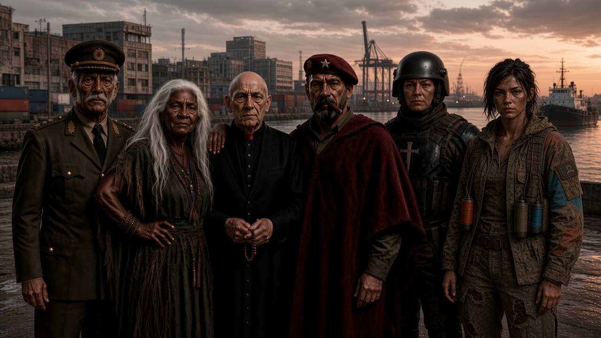

# Cadena de Mando — referencia visual

## Versión final y leyenda

Referencia visual conservada el 7 de noviembre de 2026. Decisiones de Gabriel transmitidas por Grace Hopper; leyenda final recibida a las 20:10 ART (Buenos Aires) y reiterada por Comendador.

De izquierda a derecha:

1. El General de la Confederación
2. La Bruja de la Gente del Pantano
3. Monseñor Inquisidor
4. El Comandante del Ejército Rojo del Sur
5. La Madre Superiora de las Hermanas de Batalla
6. Alguno de los Sin Nombre

Estas son las denominaciones finales de la leyenda, no nombres propios individuales. «Alguno de los Sin Nombre» no fija una persona única ni un líder permanente.

## Dirección artística

Las siguientes descripciones registran la dirección de la imagen; no agregan biografías ni sustituyen la leyenda final.

1. **El General de la Confederación:** general argentino de muy alto rango, veterano, serio y de autoridad sobria, con uniforme moderno. Rostro inspirado en José de San Martín anciano y piel oscura por dirección artística. El daguerrotipo de 1848 se usó como referencia facial, no como prueba de tono de piel ni como identificación histórica del personaje.
2. **La Bruja de la Gente del Pantano:** concebida como chamán y líder espiritual de la gente del pantano; mujer muy anciana y hermosa, de piel oscura y pelo absolutamente blanco, suelto y larguísimo. Imponente y de igual autoridad; se apoya con descaro sobre el sacerdote.
3. **Monseñor Inquisidor:** sacerdote católico calvo, muy anciano y físicamente pequeño, vestido de negro con cuello rojo en lugar de blanco; el más tenebroso y el centro de la escena. «Papa» fue un tratamiento usado durante la dirección artística, no un cargo confirmado; la denominación final es «Monseñor Inquisidor».
4. **El Comandante del Ejército Rojo del Sur:** militar imponente con capa tipo poncho rojo, sombrero militar enteramente rojo con estrella blanca central y habano. Referencia gestual al Che, sin identificación histórica con él.
5. **La Madre Superiora de las Hermanas de Batalla:** mujer morena, de rostro argentino según la dirección de Gabriel y porte militar serio. Armadura oscura pesada con cruz católica. Se conserva el diseño de armadura; la versión final muestra el rostro y lleva un casco compacto ajustado. El visor ahumado inicial dio paso al rostro visible por pedido de Gabriel.
6. **Alguno de los Sin Nombre:** figura andrógina, mucho más joven que las demás, de apariencia pobre y casi feral, con mirada de inteligencia feroz. Camuflaje gastado, prendas raídas y remendadas, colores y bombas caseras como atributos visuales ficticios, sin especificaciones técnicas. La dirección inicial la describía como líder pandillera: la leyenda final prevalece y no establece un liderazgo único o permanente. Su facción se representa a la altura de las otras.

### Escenario y tratamiento

Dársena como fondo, con tratamiento visual modernizado al incorporar la sexta facción; amanecer naranja y nublado, sin banderas argentinas. Figuras humanas, realistas y serias, con atención a la edad y a los materiales.

## Límites de interpretación

- La apariencia adulta joven de la sexta figura es una interpretación visual; Gabriel no fijó una edad exacta.
- El fondo portuario industrial contemporáneo es interpretación generada. No establece monumentos, arquitectura ni geografía canónicos adicionales. La modernización visual no fija un cambio histórico o cronológico.
- No se deducen de la imagen nombres propios, biografías, cargos adicionales, relaciones, doctrina ni estructura de las facciones. Tampoco se trasladan al lore otros detalles generados.
- Las referencias a San Martín y al Che son recursos artísticos, no identidades históricas de las figuras.

## Archivo de referencia

- Imagen de destino en el vault: `6_media/seis-lideres-2026-11-07.jpg`.
- Archivo fuente preservado: `/cursor/stores/store-82f565ba-a5c5-41ba-8eed-33953bedc944/canon/seis-lideres.jpg`.
- SHA-256 de la imagen: `aa5e6e67c7d9753e56589db2cfa34750a0bc8c02b06cd50bdfa052560955c1f1`.

La ruta del archivo fuente corresponde a la box compartida, no a un enlace portable. El vínculo relativo de esta nota requiere importar la imagen con el nombre de destino en la misma carpeta. La preparación de este archivo no implica que la nota o la imagen ya estén incorporadas al vault.

Referencia histórica consignada por la fuente para el daguerrotipo: https://museohistoriconacional.cultura.gob.ar/noticia/san-martin-daguerrotipo/
